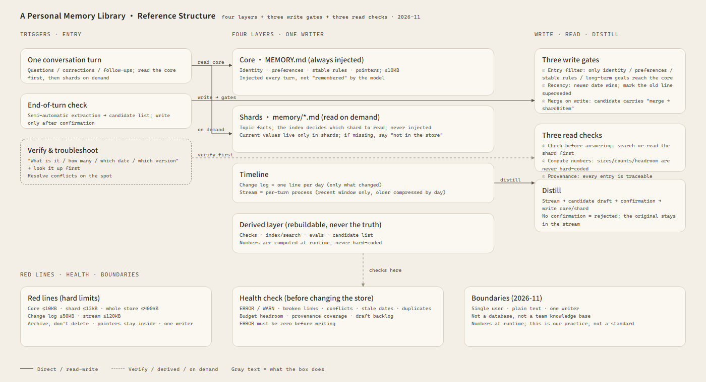

# A Personal Memory Library · Reference Structure

One person, one store, a few plain-text files: the core is injected every turn, details are read on demand, the timeline only appends, the derived layer can be deleted and rebuilt.

**This is our practice, not a standard.** Take the zoning, leave the rules, or take the whole thing and change it.

## Four layers

| Layer | What lives there | How it is used |
| --- | --- | --- |
| Core `MEMORY.md` | identity, preferences, stable rules, pointers | injected every turn, ≤10KB, conclusions only |
| Shards `memory/*.md` | topic facts | read via an index, never auto-injected |
| Timeline `CHANGELOG.md` | one line per day, only what changed | append-only |
| Derived `_state/` | index, health checks, candidates | rebuildable, never the truth |

## Three ways in

- **Just want the idea**: look at the diagram. It is closer to real use than any prose.
- **Want to run it**: `SPEC.md` is our version and its self-check rules. Copy it and it runs, but you do not have to obey it.
- **Want your own**: give the diagram to your AI and let it ask you ten questions first — what to remember, how you speak, how often you look, what you fear losing — then design the structure together. The rules are yours.

## Boundaries

- single user, single writer, plain text
- not a database, not a team knowledge base
- no panels, no UI, no extensions, no compatibility promise
- a share, not a product; issues are welcome, slowly

## What is in this repository

- `SPEC.md` / `SPEC.en.md`: our version (Chinese / English), safe to ignore entirely
- `docs/architecture-zh.png` / `architecture-en.png`: the diagram above
- `CHANGELOG.md`, `LICENSE`

Tooling (skill, plugin, schemas) is **not** shipped here; whether you want tools, and which, is your call.

## License

Text CC BY 4.0; sample code (if any) MIT. See [`LICENSE`](LICENSE).
