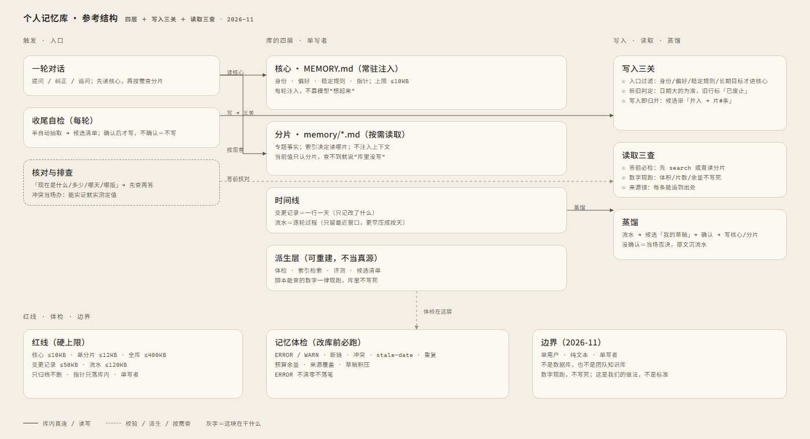

# 个人记忆库 · 参考结构

一个人、一个库、几份纯文本：核心每轮注入，细节按需读，时间线只追加，派生层可删可重建。

**这是我们的做法，不是标准。** 你可以只借分区，不借规则；也可以整套拿走，改成自己的。

## 四层

| 层 | 放什么 | 怎么用 |
| --- | --- | --- |
| 核心 `MEMORY.md` | 身份、偏好、稳定规则、指针 | 每轮注入，≤10KB，只放结论 |
| 分片 `memory/*.md` | 专题事实 | 按索引读，不自动进上下文 |
| 时间线 `CHANGELOG.md` | 一行一天，只记改了什么 | 只追加，不回头改 |
| 派生层 `_state/` | 索引、体检、候选 | 可删可重建，不当真源 |

## 三条路径

- **只想看懂**：看上面这张图。它比文字更接近真实用法。
- **想直接跑**：`SPEC.md` 是我们这一版的写法与自检规则。照抄能跑，但不要求你遵守。
- **想改成自己的**：把这张图丢给你的 AI，让它先问你十个问题——想记什么、怎么说话、多久看一次、怕丢什么——再一起定结构。规则由你们俩定。

## 边界

- 单用户、单写者、纯文本
- 不是数据库，不是团队知识库
- 不提供面板、界面、扩展、兼容承诺
- 这是分享，不是产品；接受 issue，慢慢改

## 仓库里有什么

- `SPEC.md` / `SPEC.en.md`：我们这一版的写法（中文 / English），可整套忽略
- `docs/architecture-zh.png` / `architecture-en.png`：上面这张图
- `CHANGELOG.md`、`LICENSE`

配套工具（技能、插件、schema）**不随本仓库发布**；要不要工具、用什么工具，是你自己的事。

## 许可

文本 CC BY 4.0；示例代码（如有）MIT。见 [`LICENSE`](LICENSE)。
